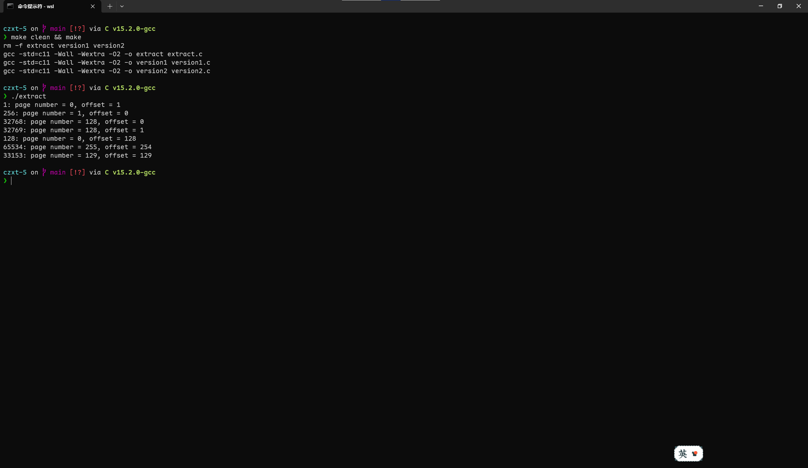
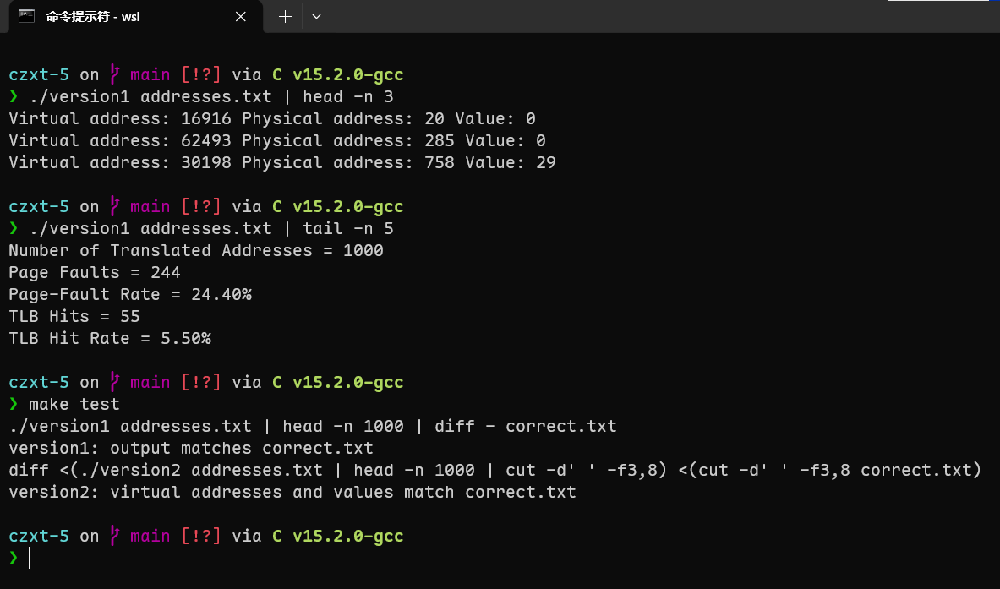
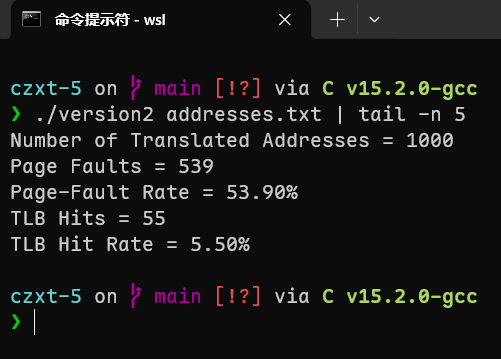
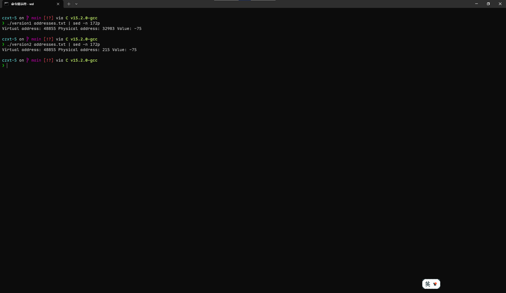
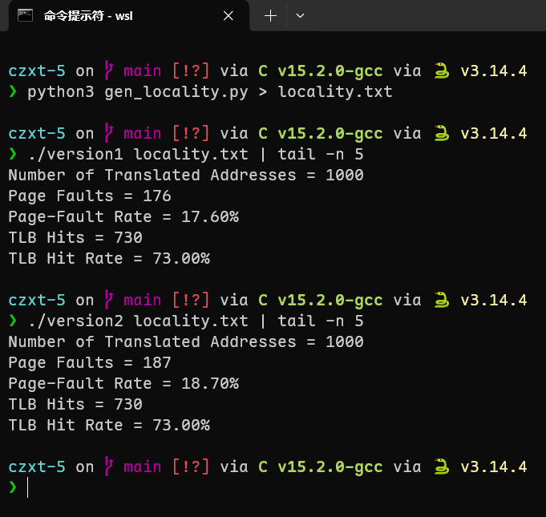

# Lab05 实验报告：设计虚拟内存管理器

## 1. 实验概述

本实验用 C 语言模拟虚拟内存管理中的地址转换：读入一组逻辑地址，借助 TLB 和页表转换为物理地址，缺页时按需从后备存储调入页面，输出物理地址处的有符号字节值，并统计缺页率和 TLB 命中率。实验分为两个版本：

- **version1**（[version1.c](version1.c)）：物理内存 256 帧，与虚拟地址空间等大，无需页面置换。
- **version2**（[version2.c](version2.c)）：物理内存缩小为 128 帧，增加 LRU 页面置换。

基本参数：

| 参数 | 取值 |
|---|---|
| 虚拟地址空间 | 2^16 = 65,536 字节，逻辑地址取低 16 位 |
| 页大小 = 帧大小 | 2^8 = 256 字节 |
| 页表项数 | 2^8 = 256 |
| TLB 项数 | 16 |
| 物理内存 | version1：256 帧（65,536 字节）；version2：128 帧（32,768 字节） |
| 后备存储 | `BACKING_STORE.bin`，65,536 字节 |
| 测试输入 | `addresses.txt`，1000 个逻辑地址 |

实验环境：Ubuntu 26.04.1 LTS（WSL2，Linux 6.18.54.1-microsoft-standard-WSL2，x86_64），gcc 15.2.0，GNU Make 4.4.1，Python 3.14.4（仅用于生成局部性序列）。编译选项 `-std=c11 -Wall -Wextra -O2`，无警告。编译与运行方法见 [README.md](README.md)。

## 2. 程序设计

### 2.1 地址划分

逻辑地址是 32 位整数，只取低 16 位：高 8 位为页号，低 8 位为页内偏移。

```text
 31                          16 15              8 7               0
+-----------------------------+-----------------+-----------------+
|                             |      页号       |    页内偏移     |
+-----------------------------+-----------------+-----------------+
                                <--- 8 位 ----> <--- 8 位 ---->
```

```c
page     = (logical & 0xFFFF) >> 8;
offset   = logical & 0xFF;
physical = frame * 256 + offset;
```

### 2.2 数据结构

| 名称 | 类型 | 说明 |
|---|---|---|
| `memory` | `signed char[帧数 * 256]` | 模拟物理内存。用有符号类型，保证输出的字节值带符号 |
| `page_table` | `int[256]` | 页号到帧号的映射，`-1` 表示该页不在内存 |
| `tlb` | `struct tlb_entry[16]` | 每项含页号、帧号和 LRU 时间戳，页号为 `-1` 表示该项无效 |
| `next_free_frame` | `int` | 下一个空闲帧的编号 |
| `clock_ticks` | `unsigned long` | 全局逻辑时钟，每次访问 TLB 项或帧时递增，用作 LRU 时间戳 |
| `frame_page` | `int[128]` | 仅 version2：帧到页的反向映射，置换时由牺牲帧找到牺牲页 |
| `frame_last_used` | `unsigned long[128]` | 仅 version2：每个帧最近一次被访问的时间戳 |

### 2.3 地址转换流程

```text
translate(logical):
    page, offset = 拆分(logical)
    frame = tlb_lookup(page)              /* 1. 先查 TLB */
    if frame 无效:                        /*    TLB 未命中 */
        frame = page_table[page]          /* 2. 再查页表 */
        if frame 无效:                    /*    缺页 */
            frame = load_page(page)       /* 3. 按需调入 (version2 可能先置换) */
        tlb_insert(page, frame)           /* 4. 写入 TLB */
    return frame * 256 + offset
```

之后读出 `memory[物理地址]` 并输出。统计时，进入第 3 步计一次缺页，第 1 步命中计一次 TLB 命中。

### 2.4 TLB

- 16 项全相联，线性扫描。
- 采用 LRU 替换：命中和插入时都把 `clock_ticks` 的新值记入该项的时间戳，未命中后插入时选时间戳最小（最久未使用）的项替换。
- 无效项的时间戳为 0，小于任何有效项，所以空槽总是最先被占用，不需要单独判断空槽。
- 指导书允许 FIFO 或 LRU。选择 LRU，是因为时间戳同时处理了空槽、命中和替换，version2 作废 TLB 项后留下的空槽也会被自然地优先复用。

### 2.5 缺页处理（按需调页）

- 缺页时用 `fseek(backing_store, page * 256, SEEK_SET)` 定位，再用 `fread` 把 256 字节读入 `memory[frame * 256]`。后备存储以随机访问的方式使用，只在缺页时读取。
- version1 按调入顺序依次分配帧（`next_free_frame++`）。物理内存与虚拟地址空间等大，每个页最多缺页一次，帧不会用尽。这个分配顺序与 `correct.txt` 一致，例如第 1 个地址 16916（页 66，偏移 20）放入帧 0，物理地址 20；第 2 个地址 62493（页 244，偏移 29）放入帧 1，物理地址 256 + 29 = 285。
- 读取后备存储失败时，向标准错误输出原因并以状态 1 退出。

### 2.6 version2：LRU 页面置换

物理内存只有 128 帧而虚拟页有 256 个，空闲帧用尽后，缺页必须先腾出一个帧。version2 在 version1 的基础上增加：

- `frame_page` 和 `frame_last_used` 两张按帧索引的表。
- `allocate_frame()`，缺页时调用：

```text
allocate_frame():
    if 还有空闲帧: 返回下一个空闲帧
    victim = frame_last_used 最小的帧         /* 最久未使用 */
    page_table[frame_page[victim]] = -1       /* 牺牲页变为不在内存 */
    tlb_invalidate(frame_page[victim])        /* 作废 TLB 中指向牺牲页的表项 */
    return victim
```

- 每次访问（TLB 命中、页表命中、缺页后）都执行 `frame_last_used[frame] = ++clock_ticks`。TLB 命中时不经过页表，如果只在页表路径上刷新时间戳，经常由 TLB 命中的页会被误认为久未使用而被换出。
- 被换出页的 TLB 表项必须作废。否则该页的帧被新页覆盖后，对旧页的访问仍会命中陈旧的 TLB 项，读到新页的内容。

选择 LRU 作为置换策略，是因为它利用访问的时间局部性，并且不会出现 Belady 异常。

### 2.7 统计与异常处理

- 缺页率 = 缺页次数 / 地址总数，TLB 命中率 = TLB 命中次数 / 地址总数，均以百分比输出。
- 地址文件为空时只输出地址总数，不输出比率，避免除零。
- 参数个数不对、地址文件或 `BACKING_STORE.bin` 打不开、读取页面失败时，向标准错误输出原因并以状态 1 退出。

## 3. 实验结果与分析

下面的截图均在项目目录 `czxt-5` 下的 WSL 终端中运行得到，图片存放在 [screenshots](screenshots/) 目录；每张截图上方的代码块给出了对应的命令。

### 3.1 编译与页号、偏移提取

运行下面的命令编译全部程序，并对指导书给出的 7 个整数提取页号和页内偏移（图 1）：

```bash
make clean && make
./extract
```



*图 1　编译与页号、偏移提取*

与手工计算一致，例如 33153 = 0x8181，页号 0x81 = 129，偏移 0x81 = 129。

### 3.2 version1：256 帧

运行 version1，查看前 3 行输出和统计信息，再用 `make test` 与 `correct.txt` 比对（图 2）：

```bash
./version1 addresses.txt | head -n 3
./version1 addresses.txt | tail -n 5
make test
```



*图 2　version1 的输出、统计信息与 `make test` 校验*

分析：

- 前 1000 行输出与 `correct.txt` 逐行一致，说明地址拆分、TLB、页表和按需调页都正确。图 2 中 `make test` 对 version1 没有 diff 输出，只打印了 `version1: output matches correct.txt`。
- 缺页 244 次（图 2），恰好等于 `addresses.txt` 中不同页的数量：

  ```text
  $ awk '{print int(($1 % 65536)/256)}' addresses.txt | sort -un | wc -l
  244
  ```

  version1 没有页面置换，每个页只在第一次被访问时缺页一次。
- TLB 命中 55 次，命中率只有 5.50%（图 2）。`addresses.txt` 是均匀随机的，没有局部性。在这样的序列上，TLB 稳态下保存最近访问的 16 个不同页，下一次访问命中的概率约为 16/256 = 6.25%。启动阶段 TLB 尚未装满，实测 5.50% 略低于这个值。
- TLB 在这个序列上几乎没有作用。假设一次内存访问 100 ns，忽略 TLB 自身的查找时间，只看地址转换的访存开销：命中 TLB 时访存 1 次，未命中时先访问页表再访问内存，共 2 次。有效访问时间 EAT = α × 100 + (1 − α) × 200 ns（α 为 TLB 命中率），α = 5.50% 时 EAT = 194.5 ns，几乎等于没有 TLB 时的 200 ns。这里的 100 ns 是示例假设，不是实测值，也没有计入缺页的磁盘开销。

### 3.3 version2：128 帧

运行 version2 并查看统计信息（图 3）：

```bash
./version2 addresses.txt | tail -n 5
```



*图 3　version2 的统计信息*

图 3 中 version2 缺页 539 次（53.90%），TLB 命中 55 次（5.50%）。version2 的物理地址与 `correct.txt` 不同（只有 128 帧，发生了页面置换），但每行的逻辑地址和字节值都与 `correct.txt` 一致（图 2 中 `make test` 的第二项检查）。

**首次置换。** 第 172 次访问（逻辑地址 48855，页 190）是第 129 次缺页，也是第一次需要置换：128 个帧已全部占用，最久未使用的是页 66（帧 0）。version1 把页 190 放入新的帧 128，version2 换出页 66、复用帧 0，所以同一行的物理地址不同（分别为 32983 和 215），字节值相同（均为 -75）。用 `sed -n 172p` 取出两个版本输出的第 172 行，结果见图 4：

```bash
./version1 addresses.txt | sed -n 172p
./version2 addresses.txt | sed -n 172p
```



*图 4　第 172 个地址在两个版本中的输出*

**缺页构成。** 缺页可以分为两类：页第一次被访问时的缺页（序列中有多少个不同页就有多少次），以及页被换出后再次被访问时的缺页。

| 版本 | 缺页次数 | 页第一次被访问 | 被换出后再次调入 |
|---|---|---|---|
| version1 | 244 | 244 | 0 |
| version2 | 539 | 244 | 295 |

version2 的 539 次缺页中，前 128 次装入空闲帧，之后 411 次都伴随一次置换。缺页率从 24.40% 升到 53.90%，增加的 29.50 个百分点全部来自第二类缺页。

**与简单模型的对照。** 假设访问相互独立、各页等概率（`addresses.txt` 是均匀随机生成的，近似符合）：

- 1000 次访问预计碰到 256 × (1 − (255/256)^1000) ≈ 250.9 个不同页，实测 244。
- 稳态下 LRU 使内存保存最近访问的 128 个不同页，下一次访问缺页的概率约为 1 − 128/256 = 50%。不同页数增长到 128 大约需要 ln 0.5 / ln(255/256) ≈ 177 次访问，之后每次访问约一半缺页。估算缺页数为 128 + 0.5 × (1000 − 177) ≈ 540，实测 539，实测的首次置换发生在第 172 次访问，也与 177 接近。

在上述独立均匀访问的假设下，任何不预知未来的置换算法的缺页概率都约为 50%，置换算法的选择对缺页率影响很小，缺页率主要取决于驻留页占总页数的比例。

**TLB 命中数与 version1 相同。** version2 的 TLB 命中数是 55，与 version1 完全相同。原因在于 LRU 的包含性质：LRU 页面置换使内存中保存的是最近访问的页，而 LRU TLB 的 16 项是最近访问的 16 个不同页，必然包含在最近访问的 128 个不同页之内。所以被换出的页（最久未使用的页）不会在 TLB 中，置换不会影响 TLB 的内容，两个版本的 TLB 命中序列完全一致。

### 3.4 带局部性的地址序列

指导书提示可以生成带局部性的序列以获得更高的命中率。仓库中的 [gen_locality.py](gen_locality.py) 生成 1000 个这样的地址：分为 50 个阶段，每个阶段 20 次访问；每个阶段随机选 6 个页作为热点页，阶段内每次访问从这 6 个页中随机取一页，页内偏移随机。用固定种子的线性同余发生器，保证序列可以复现。脚本内容如下：

```python
# 带局部性的地址序列: 50 个阶段, 每阶段 20 次访问, 每阶段从 6 个热点页中取页
x = 2024


def rnd(n):
    global x
    x = (1103515245 * x + 12345) % 2**31
    return (x >> 16) % n


addrs = []
for _ in range(50):
    hot = [rnd(256) for _ in range(6)]
    for _ in range(20):
        addrs.append(hot[rnd(6)] * 256 + rnd(256))
print("\n".join(map(str, addrs)))
```

用该脚本生成序列文件 `locality.txt`，再分别运行两个版本并查看统计信息（图 5）：

```bash
python3 gen_locality.py > locality.txt
./version1 locality.txt | tail -n 5
./version2 locality.txt | tail -n 5
```



*图 5　局部性序列上两个版本的统计信息*

分析：

- **TLB 命中率从 5.50% 升到 73.00%。** 每个阶段里，每个热点页第一次被访问时（除非它还留在 TLB 中）必然未命中，6 个热点页、50 个阶段共约 300 次未命中，估算命中率约为 70%。实测 73.00% 略高，是因为 20 次访问不一定覆盖全部 6 个热点页，热点页有时也与前面阶段的页重合而仍留在 TLB 中。按前面的假设，EAT = 0.73 × 100 + 0.27 × 200 = 127.0 ns，比随机序列的 194.5 ns 低约三分之一。
- **version1 缺页 176 次**，等于序列中不同页的数量，与前面的结论一致。
- **version2 缺页 187 次**，其中 128 次装入空闲帧，59 次伴随置换；按另一种分类，176 次是页第一次被访问，只有 187 − 176 = 11 次是页被换出后再次调入。热点页恰好是最近使用的页，LRU 把它们留在内存中，所以缺页率只比 version1 高 1.10 个百分点；随机序列上这个差距是 29.50 个百分点。页面置换算法的价值只有在访问有局部性时才体现出来。
- version2 的 TLB 命中数仍与 version1 相同（730），同样由 LRU 的包含性质决定。

### 3.5 汇总

| 地址序列 | 版本 | 缺页次数 | 缺页率 | TLB 命中次数 | TLB 命中率 |
|---|---|---|---|---|---|
| `addresses.txt`（随机） | version1 | 244 | 24.40% | 55 | 5.50% |
| `addresses.txt`（随机） | version2 | 539 | 53.90% | 55 | 5.50% |
| 局部性序列 | version1 | 176 | 17.60% | 730 | 73.00% |
| 局部性序列 | version2 | 187 | 18.70% | 730 | 73.00% |

在这两条序列上，TLB 命中率只取决于访问序列的局部性，两个版本相同（原因见 3.3）；缺页率同时取决于物理内存的大小和访问序列的局部性。物理内存减半后，随机访问的缺页率翻倍以上，而有局部性的访问几乎不受影响。

### 3.6 正确性验证

1. `make test`：version1 的输出与 `correct.txt` 完全一致；version2 的逻辑地址和字节值与 `correct.txt` 一致（图 2）。
2. 独立参考实现：另用 Python 写了一个 LRU 页面置换与 LRU TLB 的模拟（以 `OrderedDict` 维护最近使用顺序，与 C 代码各自独立编写）。对 `addresses.txt` 和局部性序列，version1、version2 的每一行输出（逻辑地址、物理地址、字节值）以及缺页次数、TLB 命中次数都与参考实现一致，所有字节值也都等于 `BACKING_STORE.bin` 中对应位置的字节。
3. 用 `-fsanitize=address,undefined` 构建两个版本，在 `addresses.txt` 上运行，没有报错。
4. 边界输入：空地址文件、大于 16 位的地址（2147435028、82452 与 16916 得到相同的页号、偏移和物理地址 20）、无参数、地址文件不存在、当前目录没有 `BACKING_STORE.bin`，行为均符合预期。

## 4. 遇到的问题及解决方案

1. **`correct.txt` 的帧分配规则没有说明。** 指导书没有写明 `correct.txt` 中物理地址是怎样得到的。从前两行（物理地址 20 和 285）可以看出，帧是按缺页的先后顺序从 0 开始依次分配的。version1 据此用 `next_free_frame++` 分配帧，结果与 `correct.txt` 逐行一致。

2. **32 位地址与有符号字节。** 逻辑地址是 32 位整数，必须先屏蔽低 16 位再拆分页号和偏移，否则大于 65535 的值会得到错误的页号。输出要求有符号字节，而 C 中 `char` 是否带符号由平台决定，所以显式使用 `signed char`。

3. **version2 无法直接用 `correct.txt` 校验物理地址。** 只有 128 帧且发生置换，物理地址必然与 `correct.txt` 不同。解决办法是分两层验证：`make test` 比较逻辑地址和字节值；另写独立的 LRU 参考模拟，逐行核对物理地址和统计数据（见 3.6）。

4. **TLB 命中时也要刷新 LRU 时间戳。** TLB 命中不经过页表，若只在页表路径上刷新帧的时间戳，由 TLB 命中的常用页会被误认为久未使用而被换出。为了确认参考模拟能发现这类错误，临时把刷新语句改成只在 TLB 未命中时执行，缺页次数从 539 变为 537，与参考模拟的逐行比对立即出现差异。正式版本在每次访问时都刷新。

5. **页面置换后 TLB 的一致性。** 页被换出后，它的帧会被新页覆盖，TLB 中指向它的旧映射必须同步作废（`tlb_invalidate`），否则后续对该页的访问会命中陈旧的帧，读到别的页的内容。随机序列测不出这个问题：临时把置换策略改为 FIFO 并去掉作废操作，在 `addresses.txt` 上的输出仍全部正确，因为页被换出后紧接着再次被访问的概率很小。构造一个"访问页 j，触发换出页 j，再访问页 j"的序列（64 轮）后，去掉作废操作会读错 64 处，保留则全部正确。

6. **version2 的 TLB 命中数与 version1 完全相同，乍看像是实现错误。** 分析后确认是 LRU 的包含性质造成的（见 3.3）。验证方式：在 `addresses.txt` 上统计 `tlb_invalidate` 实际作废的 TLB 项数，结果为 0；去掉这个调用后 version2 的输出不变。在 LRU 配置下作废操作不会触发，但保留它能让置换策略改为 FIFO 等其他策略时仍然正确（见第 5 项）。

7. **空输入与异常输入。** 空地址文件会使比率的分母为 0，因此地址总数为 0 时只输出总数。参数个数不对、文件打不开、读取页面失败时输出原因并以状态 1 退出。

问题 4、5、6 中用于验证的临时改动没有保留在仓库中。

## 5. 教材中的内存管理方法总结

本实验的题目出自《操作系统概念》（Silberschatz 等）的编程项目。下面按该书"主存"与"虚拟内存"两部分的内容归纳各种内存管理方法。

### 5.1 连续内存分配与交换

- **基址寄存器与界限寄存器**：每个进程占用一段连续的物理内存，CPU 检查每次用户态访问是否落在 [基址, 基址 + 界限) 内，既完成重定位也提供保护。
- **动态分区**：空闲内存形成大小不一的"孔"，分配时可采用首次适应（第一个足够大的孔）、最佳适应（最小的足够大的孔）或最差适应（最大的孔）。
- **碎片**：外部碎片指空闲内存总量够用但不连续，可通过紧缩缓解；内部碎片指分配的块大于请求的大小。统计分析表明，首次适应下可能有约三分之一的内存因碎片而无法使用（50% 规则）。
- **交换**：把暂时不运行的进程整体换出到后备存储，需要时再换入，使进程占用的内存总量可以超过物理内存，代价是换入换出的 I/O 开销很大。

### 5.2 分段

把程序看作段的集合（主程序、函数、栈、符号表等），逻辑地址为（段号，段内偏移），由段表给出每段的基址和界限。分段符合程序员对内存的看法，便于按段保护和共享；但段的长度不一，仍会产生外部碎片。

### 5.3 分页与页表结构

- **分页**：把逻辑地址空间划分为固定大小的页，物理内存划分为同样大小的帧，页表记录页到帧的映射。任何页都可以放入任何空闲帧，消除了外部碎片，只在进程最后一页可能有内部碎片。
- **硬件支持**：页表放在内存中，页表基址寄存器指向它，每次访问需要两次内存访问。TLB 缓存最近使用的页表项以加速转换，表项常带有地址空间标识符（ASID）。有效访问时间 = α × (TLB 查找 + 一次访存) + (1 − α) × (TLB 查找 + 两次访存)，α 为 TLB 命中率。
- **保护与共享**：页表项中的有效-无效位、只读/读写位提供保护；多个进程可以共享可重入代码所在的页。
- **页表结构**：层次页表把页表本身再分页，避免连续的大页表；哈希页表适合大于 32 位的地址空间；倒排页表为每个物理帧设一项，节省页表占用的内存，但查找需要搜索或哈希，共享页也更难实现。
- **实例**：IA-32 采用分段加分页，x86-64 和 ARM 采用多级页表。

### 5.4 请求调页与页面置换

- **请求调页**：页面只有在被访问时才调入内存。页表项的有效-无效位表示页是否在内存，访问不在内存的页会产生缺页中断。
- **缺页处理**：陷入操作系统并检查访问是否合法；找到空闲帧；调度磁盘把所需页读入该帧；修改页表；重新执行被中断的指令。
- **有效访问时间**：EAT = (1 − p) × 内存访问时间 + p × 缺页服务时间，p 为缺页率。磁盘比内存慢几个数量级，所以 p 必须非常小。
- **页面置换**：没有空闲帧时选出牺牲页换出，修改位（脏位）可以避免写回未被修改的页。
- **写时复制**：`fork` 之后父子进程共享页面，直到某一方写入才复制该页。

| 置换算法 | 思想 | 特点 |
|---|---|---|
| FIFO | 换出最早调入的页 | 实现简单；可能出现 Belady 异常（帧数增加，缺页反而增加） |
| OPT | 换出未来最长时间不会再使用的页 | 缺页率最低，但需要预知未来，只能作为比较基准 |
| LRU | 换出最久未使用的页 | 接近 OPT，没有 Belady 异常；精确实现需要硬件支持（时间戳或栈） |
| 二次机会（时钟） | 引用位为 1 的页清零后再给一次机会 | 近似 LRU，开销小 |
| LFU / MFU | 按引用次数换出 | 实现代价高、效果一般，较少使用 |

### 5.5 其他内容

- **帧分配**：每个进程有最少帧数的要求；可以平均分配或按比例分配；置换可以是全局的，也可以是局部的。
- **抖动**：进程得不到足够的帧时频繁缺页，CPU 利用率反而下降。可以用工作集模型或缺页频率方案控制每个进程的帧数。
- **内核内存分配**：伙伴系统和 slab 分配。
- **其他考虑**：预调页、页大小的选择、TLB 覆盖范围、I/O 互锁与页面锁定等。

### 5.6 方法对比

| 方法 | 核心思想 | 优点 | 缺点 |
|---|---|---|---|
| 连续分配 | 每个进程占一块连续物理内存，用基址/界限寄存器保护 | 硬件简单，转换快 | 外部碎片，需要紧缩；进程必须整体驻留 |
| 交换 | 暂不运行的进程整体换出到后备存储 | 内存总需求可超过物理内存 | 换入换出开销大 |
| 分段 | 按逻辑单位划分，地址为（段号，偏移） | 符合程序员视角，便于共享和保护 | 段长不一，有外部碎片 |
| 分页 | 固定大小的页映射到任意帧 | 无外部碎片，分配简单 | 有内部碎片；页表占内存，需要 TLB 加速 |
| 层次、哈希、倒排页表 | 改变页表的组织方式 | 减少页表占用的连续空间或内存 | 增加访存次数或查找开销 |
| 请求调页 | 访问时才调入页面 | 程序可以大于物理内存，可同时运行更多进程 | 缺页代价高，需要页面置换，可能抖动 |

本实验实现的是单级页表的分页、TLB、请求调页，以及 version2 中的 LRU 页面置换。分段、多级页表、写回、帧分配策略不在实验范围内。

## 6. 参考资料

1. Abraham Silberschatz, Peter B. Galvin, Greg Gagne. *Operating System Concepts*. Wiley.（主存与虚拟内存两部分，以及书中的编程项目 "Designing a Virtual Memory Manager"；具体版本以课程所用教材为准。）
2. 实验指导书 [Lab05.zh.md](Lab05.zh.md)、[Lab05.md](Lab05.md)。
3. Linux 手册页：`fopen(3)`、`fseek(3)`、`fread(3)`、`fscanf(3)`。
4. Wikipedia: [Translation lookaside buffer](https://en.wikipedia.org/wiki/Translation_lookaside_buffer)。
5. Wikipedia: [Page replacement algorithm](https://en.wikipedia.org/wiki/Page_replacement_algorithm)。
6. Wikipedia: [Demand paging](https://en.wikipedia.org/wiki/Demand_paging)。

## 7. 建议与评论

1. **说明 `correct.txt` 的帧分配规则。** 指导书没有写明物理地址是按缺页顺序从帧 0 开始依次分配的，需要从数据反推。写明这一点，学生就可以直接比对物理地址。
2. **提供页面置换阶段的参考输出。** 128 帧的版本没有对应的参考输出，学生无法判断物理地址是否正确。可以提供参考输出，或者说明只比较逻辑地址和字节值即可，本实验的 `make test` 就是这样做的。
3. **提供带局部性的测试序列。** `addresses.txt` 是均匀随机的，TLB 命中率天然只有 6% 左右，也体现不出置换算法的差别。配套一个有局部性的序列，或者给出生成方法（如 3.4 节的脚本），实验现象会更明显。
4. **提示 LRU 的实现细节。** TLB 命中时也要刷新帧的访问时间，换出页时要作废 TLB 中的旧映射，这两点很容易漏掉，而且都不影响字节值，只比对 `correct.txt` 发现不了。
5. **统一统计信息的输出格式。** 指导书只要求报告缺页率和 TLB 命中率，没有规定格式。统一格式便于对照和评阅。
